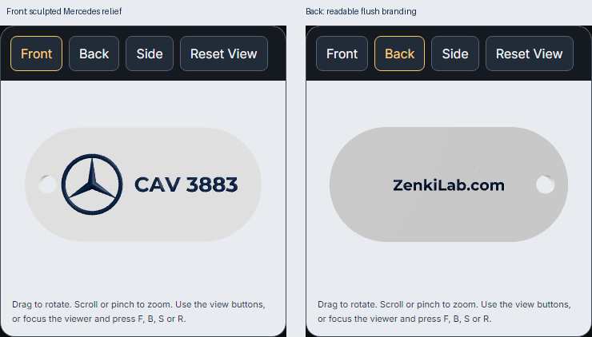

# Interactive viewer verification — 14 November 2026

The Automotive page now offers an actual browser-rendered Mercedes solid model with mouse/touch rotation, wheel/pinch zoom, Front/Back/Side/Reset View controls, live colors and personalized shape/border/registration updates. Other manufacturers remain explicitly labeled conceptual SVG previews with inquiries. The original Custom Key Tag scene/exporter and all 70 approved customer export files are unchanged.

Architecture and lifecycle: [INTERACTIVE_VIEWER.md](../../INTERACTIVE_VIEWER.md). Existing React Three Fiber Canvas, Drei OrbitControls and the Custom viewer's directional/ambient lighting are reused. The original Automotive Boolean builder now supplies both the display and export snapshots, with no second geometry generator or new dependency. Only the body rendering uses flat face shading; the sculpted emblem and manufactured geometry are unchanged.

[Open the verified Cloudflare preview](https://feature-automotive-keytags-l.zenkilab.pages.dev/preview/automotive-keytags/zgK-bGNzkybwN8aPd8e_26sDpxL0GRCX).

| Validation | Result / evidence |
|---|---|
| Production build, TypeScript and Pages Function bundle | PASS |
| Browser interaction at 320/390/768/1024/1440 px | PASS, [live/browser.json](live/browser.json) |
| Both shapes and four borders at every width | 40 combinations PASS |
| Mouse rotation, wheel zoom, all four presets and reset after zoom | PASS at all five widths |
| Touch rotation and pinch | PASS at 320 and 390 px, Chromium touch emulation |
| Colors/camera preserve the same geometry instance | PASS |
| Rapid registration input | One final replacement model after debounce |
| GPU lifecycle | Exactly two live rendered geometries after updates; old models/contexts removed on brand switching |
| Reduced motion / context loss | Stable idle camera at all widths; lost-context capture refused with selections retained |
| CAD-to-export parity | 16 configurations PASS, [cad-parity.json](cad-parity.json) |
| Previous serialized geometry | Eight earlier STL outputs remain byte-identical |
| Export while replacing/discarding a display | PASS, synchronous snapshots survive old-model disposal |
| CAD resource disposal | Both geometry/material pairs plus complete union disposed |
| 15 pending-brand SVGs | 1,200 live fitting cases PASS, [live-fitting/live-regression.json](live-fitting/live-regression.json) |
| All 16 brand renderers | [Actual website contact sheet](live-fitting/all-16-contact-sheet.png) |
| Shared submission integration / Custom regression | [Local HTTP/D1 browser test](submission/browser.json) PASS; email provider mocked |
| Existing Custom source / customer-approved files | [Preservation report](preservation.json) PASS |
| Honest inquiry message and F/B/S/R keys | [Local regression](message-keyboard.json) PASS; same reusable script included for live handover |

The live reports identify their tested executable commit. The full camera suite is recorded against `f1dacf484cacd086b50649473d02671afb7b8c7d`. Final handover repeats the deployed readiness, original-product and keyboard/message checks after the evidence commit. No valid live submission, real email or printer command is sent by these viewer tests.

## Real browser screenshots

| Width | Front | Back |
|---|---|---|
| 320 | [Front](live/front-320.png) | [Back](live/back-320.png) |
| 390 | [Front](live/front-390.png) | [Back](live/back-390.png) |
| 768 | [Front](live/front-768.png) | [Back](live/back-768.png) |
| 1024 | [Front](live/front-1024.png) | [Back](live/back-1024.png) |
| 1440 | [Front](live/front-1440.png) | [Back](live/back-1440.png) |

[Side at 390 px](live/side-390.png), [Side at 1440 px](live/side-1440.png). The Side preset shows the entire long edge and relief thickness. The Back preset displays the actual mirrored `ZenkiLab.com` geometry in readable orientation, with the keyring hole on the right.

Samples: [capsule STL](capsule.stl), [capsule 3MF](capsule.3mf), [R5 rectangle STL](rounded-rectangle.stl), [R5 rectangle 3MF](rounded-rectangle.3mf). These are color-separated, UNSLICED geometry samples for `ABC 1234`, not slicer-ready print jobs.

## Release status

The viewer requirement passes independently of backend release readiness. The live backend reports storage health 200/D1, private unauthenticated access 401 and overall readiness false because Preview Resend is missing; see [live-health/live.json](live-health/live.json). The previously confirmed full-submission CPU limitation and real-email delivery gate remain unresolved. [Release gates](../d1-storage/release-gates.json) remain failed overall. Main stays `4c6f3fd741d26026f234be067a5284c763312a0c`; nothing was merged or deployed to production.

Exact scoped files: [changed-files.json](changed-files.json). Existing unrelated working files were excluded.
